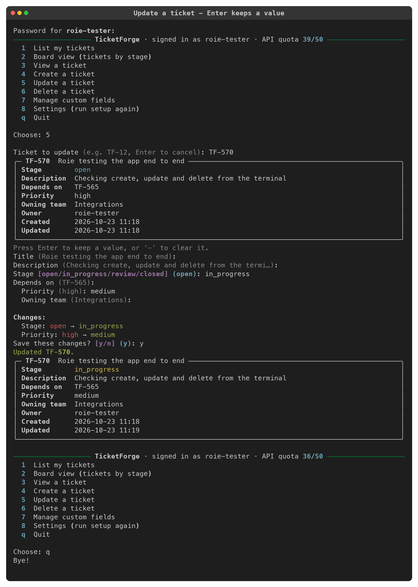
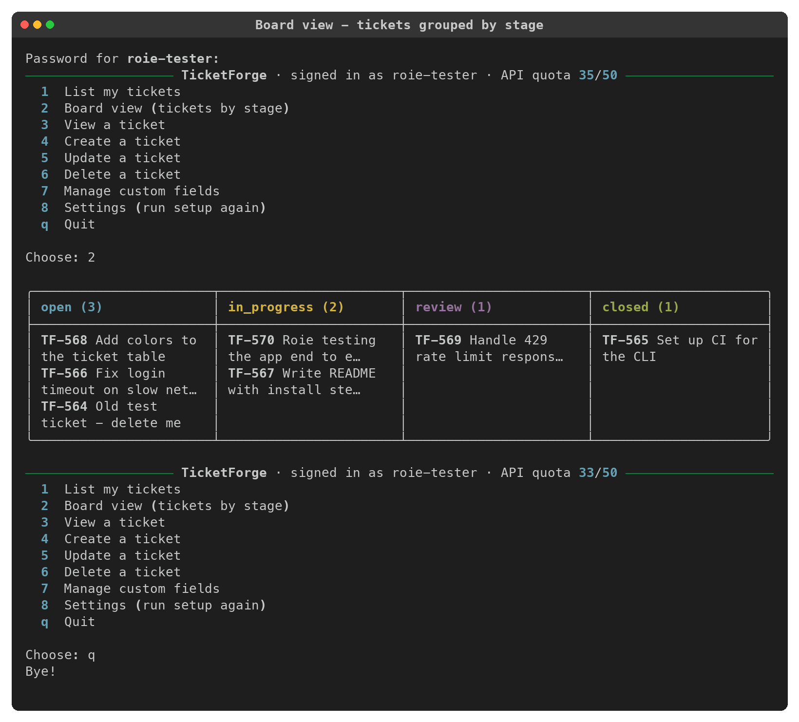

# ticketforge-cli

An interactive command-line client for [TicketForge](https://integrations-assignment-ticketforge.vercel.app).
It lets you set up a connection and then list, view, create, update and delete
tickets, and manage custom fields, all from the terminal.

TicketForge has no public API docs, so the integration is based on reverse
engineering the web app. What I found is written up in
[docs/API_NOTES.md](docs/API_NOTES.md).



## Features

- **Setup wizard**: point the CLI at a server, log in to an existing account or
  register a new one. Credentials are checked before anything is saved.
- **Tickets**: list (with next/previous paging), view, create, update and delete.
- **Board view**: all your tickets in one kanban-style table with a column per
  stage (`open`, `in_progress`, `review`, `closed`) and a count in each header.
  The web app has nothing like this; it only shows a flat list. See
  [Board view](#board-view) below.
- **Safe updates**: the API's `PUT` replaces the whole ticket, so the CLI merges
  your edits into the current ticket. Changing the stage never wipes the
  description or custom fields by accident. You see a before → after summary
  before anything is saved.
- **Dependencies & custom fields**: set "depends on" refs and fill in custom
  fields when creating or editing. Custom fields can also be added, renamed and
  deleted.
- **Rate limits and retries**: on a 429 the client waits for `Retry-After` and
  retries. The header shows how much of your quota is left (`API quota 42/50`).
  Network errors and 5xx responses are retried with backoff, but only for GET,
  PUT and DELETE. A POST that timed out may already have created the ticket, and
  retrying it could create a duplicate.
- **Friendly input**: `tf-12` and `12` both work as `TF-12`, the server's error
  messages are shown as-is, and Ctrl-C cancels the current action without
  quitting.

## Installation

Requires Python 3.10+.

```bash
git clone https://github.com/roiesu/ticketforge-cli.git
cd ticketforge-cli
python3 -m venv .venv
source .venv/bin/activate
pip install -e .            # or: pip install -e ".[dev]" to also get the test tools
```

## Running

```bash
tforge            # start the app (runs setup automatically the first time)
tforge setup      # run setup again: change server or account
python -m tforge  # same thing, without the console script
```

### Setup

On first run you're asked for:

1. **Server URL**. Defaults to the hosted TicketForge instance.
2. Whether you **already have an account**. If not, the CLI registers one for you.
3. **Username and password**.

The server URL and username are saved to `~/.config/ticketforge/config.json`
(you can override the folder with `TICKETFORGE_CONFIG_DIR`). **The password is
never written to disk.** It's asked for when the app starts, or read from the
`TICKETFORGE_PASSWORD` environment variable if that's set:

```bash
export TICKETFORGE_PASSWORD='...'   # optional, skips the password prompt
tforge
```

## Example usage

```
─────────────────── TicketForge · signed in as roie-tester · API quota 49/50 ───────────────────
  1  List my tickets
  2  Board view (tickets by stage)
  3  View a ticket
  4  Create a ticket
  5  Update a ticket
  6  Delete a ticket
  7  Manage custom fields
  8  Settings (run setup again)
  q  Quit

Choose: 4

Title: Roie testing the app end to end
Description (optional): Checking create, update and delete from the terminal
Depends on, comma-separated refs (optional): 565
Custom fields - press Enter to skip:
  Priority: high
  Owning team: Integrations
Created TF-570 - Roie testing the app end to end
```

Listing tickets pages through the results 5 at a time (the server's maximum page size):

```
My tickets · page 1
  Ref      Title                      Stage         Description               Updated
 ━━━━━━━━━━━━━━━━━━━━━━━━━━━━━━━━━━━━━━━━━━━━━━━━━━━━━━━━━━━━━━━━━━━━━━━━━━━━━━━━━━━━━━━━━━━━━━
  TF-570   Roie testing the app end   open          Checking create, update   2026-10-23 11:18
           to end                                   and delete from…
  TF-569   Handle 429 rate limit      review        Wait for Retry-After      2026-10-23 11:18
           responses                                and try again
  ...
n next · v <ref> view · Enter to go back: n
```

Updating: press Enter to keep a value, or type `-` to clear it. You see only what
actually changed before saving:

```
Title (Roie testing the app end to end):
Description (Checking create, update and delete from the termi…):
Stage [open/in_progress/review/closed] (open): in_progress
Depends on (TF-565):
  Priority (high): medium
  Owning team (Integrations):

Changes:
  Stage: open → in_progress
  Priority: high → medium
Save these changes? [y/n] (y): y
Updated TF-570.
```

### Board view

The list is good for paging through tickets, but it doesn't answer "where does
everything stand?". The board does: it walks every page of
`/workitems/mine` and groups the tickets by stage.



Because the API returns at most 5 tickets per page, the board stops at your 100
most recent tickets (20 requests). That keeps it well inside the 50 requests/minute
rate limit, and if you do hit the limit, the client's 429 handling takes over.

### Evidence that it runs

Real terminal sessions recorded against the live TicketForge server, one
feature per recording. Each one has a screenshot (PNG) and a plain-text copy.

| # | What it shows | Screenshot | Text |
|---|---|---|---|
| 1 | First run: setup wizard registers a new account | [png](docs/evidence/01-setup.png) | [txt](docs/evidence/01-setup.txt) |
| 2 | Custom fields: add two, rename one | [png](docs/evidence/02-custom-fields.png) | [txt](docs/evidence/02-custom-fields.txt) |
| 3 | Create a ticket with a dependency and custom fields | [png](docs/evidence/03-create-ticket.png) | [txt](docs/evidence/03-create-ticket.txt) |
| 4 | List with pagination: next page, previous page | [png](docs/evidence/04-list-pagination.png) | [txt](docs/evidence/04-list-pagination.txt) |
| 5 | View one ticket | [png](docs/evidence/05-view-ticket.png) | [txt](docs/evidence/05-view-ticket.txt) |
| 6 | Update: change stage and a custom field, keep the rest | [png](docs/evidence/06-update-ticket.png) | [txt](docs/evidence/06-update-ticket.txt) |
| 7 | Board view: tickets grouped by stage | [png](docs/evidence/07-board-view.png) | [txt](docs/evidence/07-board-view.txt) |
| 8 | Delete: cancel once, then confirm | [png](docs/evidence/08-delete-ticket.png) | [txt](docs/evidence/08-delete-ticket.txt) |
| 9 | Error handling: bad ref, another user's ticket, missing ticket, invalid dependency | [png](docs/evidence/09-error-handling.png) | [txt](docs/evidence/09-error-handling.txt) |
| 10 | Rate limiting: 55 requests against a 50/min limit (`scripts/rate_limit_demo.py`) | [png](docs/evidence/10-rate-limit.png) | [txt](docs/evidence/10-rate-limit.txt) |

In the recordings the config folder was pointed at a temporary directory with
`TICKETFORGE_CONFIG_DIR`, which is why setup saves to `/tmp/...`.

## Tests

```bash
pip install -e ".[dev]"
pytest
```

The tests mock HTTP with [`responses`](https://github.com/getsentry/responses),
so they don't touch the real server.

- `tests/test_api.py`: every endpoint (path, query and JSON body), Basic auth,
  cursor pagination, error mapping (`not_found` arrives as a 400, unknown routes
  return HTML), the full-replace update payload, and the retry rules (429 waits
  for `Retry-After`; 5xx and connection errors are retried for GET/PUT/DELETE
  but not POST).
- `tests/test_cli.py`: input parsing, plus the interactive flows driven with
  typed-in answers. These cover create, update (keep, change, or clear a value
  with `-`; no API call when nothing changed), delete confirmation, paging back
  and forth, and the setup wizard (registers, saves config, never saves the
  password).
- `tests/test_views.py`: board grouping and text truncation.
- `tests/test_config.py`: config save/load.

## Project layout

```
tforge/
  api.py      TicketForge HTTP client: endpoints, error handling, retries, rate limits
  cli.py      interactive menus, prompts, setup/login flow
  views.py    rich tables/panels: ticket list, ticket details, board, custom fields
  config.py   load/save ~/.config/ticketforge/config.json
tests/        pytest suite (HTTP mocked)
scripts/      rate_limit_demo.py - shows the 429 handling against the real server
docs/         API notes and recorded sessions
```

The API client knows nothing about the terminal. It reports retry waits through a
callback, so the UI decides how to show them. That keeps `api.py` easy to test and
reuse.

## Assumptions and limitations

- **Only your own tickets.** The API only exposes the current user's tickets
  (`/workitems/mine`), so the CLI does too.
- **Ref format.** I assume refs look like `TF-<number>`, so a bare number is
  expanded to `TF-<number>`.
- **No server-side filtering or search.** I didn't find any. Listing is
  newest-first, 5 per page.
- **New tickets start as `open`.** The create endpoint ignores `stage`, so use
  Update to move a ticket along.
- **No stage workflow.** TicketForge lets a ticket jump between any stages (e.g.
  `open` → `review` without `in_progress`), and the CLI does the same on purpose.
  The workflow is a server-side business rule. Enforcing one only in the CLI would
  make it disagree with the web app and the API, and it would block real cases
  like reopening a ticket or closing one as "won't fix".
- **Last write wins.** An update is "fetch, then PUT the whole ticket". If someone
  changes the same ticket between those two calls, their change is overwritten.
  The API has no ETag/version field to detect this.
- **Password handling.** The password isn't stored, so you're prompted on each
  start unless `TICKETFORGE_PASSWORD` is set. Storing it in the OS keychain (e.g.
  with `keyring`) would be a natural next step.
- **Retry limit.** Rate-limit/5xx retries give up after 3 attempts and show the
  server's error. A create that fails with a 5xx or a timeout is not retried. If
  that happens, check the list before creating the ticket again.
- **Board size.** The board shows your 100 most recent tickets (see above).
- **Undocumented API.** Everything in `docs/API_NOTES.md` was inferred and may
  change without notice.

## AI disclosure

I used an AI assistant (Claude, inside the Cursor editor) during this assignment.
It helped me read through the web app's minified JavaScript to list the API
calls, write the probing scripts I used to check the API's behaviour (full-replace
`PUT`, page-size cap, rate-limit headers), scaffold parts of the code and tests,
and draft this README. I made the design decisions, and I reviewed, ran and tested
everything against the live server.
